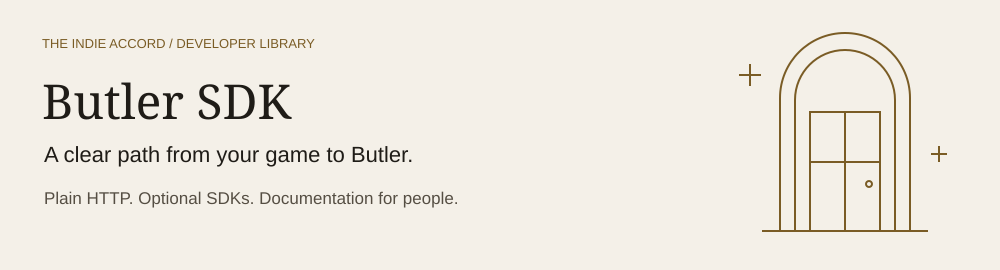

# Butler SDK



Official client libraries, API specs and test fixtures for **Butler**, the shared backend behind games from
The Indie Accord and the studios that integrate with it. Butler handles first-party game analytics, player
sign-in, accolades, feats and per-player game data.

**You do not need an SDK to use Butler.** Every feature is a documented HTTP API, and the SDKs will send exactly
the same requests you could send yourself. What the SDKs add is the work that is tedious to get right in every game:
an offline queue, batching, retries with backoff, duplicate-safe event ids, a consent switch, the remote kill
switch and sampling, and player sign-in.

**New here?** [Start with one working request](docs/start-here.md), or see [how Butler fits your game](docs/architecture.md).

## Packages

| Package | For | Status |
|---|---|---|
| [`@indieaccord/butler`](packages/ts) | Browser games, Node game servers, tools (TypeScript) | In development |
| [`com.indieaccord.butler`](packages/unity) | Unity 2022.3 LTS and newer | In development |
| [`butler.yymps`](packages/gamemaker) | GameMaker (GMS2 runtime) | Planned, analytics only |

Ports for other engines live in their own repos and are listed in [community/](community).

## A first event in three ways

With `curl`:

```bash
curl -X POST "https://doorman.stg.theindieaccord.com/game/events?ingest_token=$BUTLER_INGEST_TOKEN" \
  -H "X-Proxy-Key: $BUTLER_PROXY_KEY" -H "Content-Type: application/json" \
  -d '{ "user_id": "install-3f2a9c", "event_name": "level_complete", "metadata": { "level": 3 } }'
```

With the TypeScript SDK (planned API):

```ts
import { Butler } from '@indieaccord/butler'

const butler = Butler.init({
  env: 'staging',
  ingest: { ingestToken: import.meta.env.VITE_BUTLER_INGEST_TOKEN, proxyKey: import.meta.env.VITE_BUTLER_PROXY_KEY },
  consent: 'required', // nothing is sent until the player agrees
})

// Call this from your consent prompt. Events tracked before it wait in the queue.
butler.analytics.setConsent(true)
butler.analytics.track('level_complete', { level: 3 })
```

With the Unity SDK (planned API):

```csharp
using IndieAccord.Butler;

// Settings come from a ButlerSettings asset (Assets > Create > Butler > Settings).
Butler.Initialize(butlerSettings);
Butler.Analytics.SetConsent(true);   // from your consent prompt
Butler.Analytics.Track("level_complete", new Props { { "level", 3 } });
```

## Where to start

| If you are | Read |
|---|---|
| New to Butler | [Concepts](docs/concepts.md): keys, tiers, identity and consent in one page |
| Choosing how to integrate | [Integration paths](docs/integration-paths.md) for first-party, partner and third-party studios |
| Sending analytics without an SDK | [Raw HTTP quickstart](docs/quickstart-raw-http.md) |
| Adding accolades or saves from your server | [Game server guide](docs/guides/game-server.md) |
| Signing players in | [Player sign-in guide](docs/guides/player-sign-in.md) |
| Writing an SDK for another engine | [Conformance suite](conformance) and [CONTRIBUTING](CONTRIBUTING.md) |

The full docs index is in [docs/](docs).

## Repository layout

```
butler-sdk/
  spec/           Public OpenAPI documents. The source of truth for every request.
  conformance/    Language-neutral test fixtures. Every SDK, official or community, must pass them.
  packages/       Official SDKs: ts/, unity/, gamemaker/.
  samples/        Small games and scripts that use the SDKs.
  community/      Registry of community SDKs that pass the conformance suite.
  docs/           Concepts, guides, decisions (adr/) and maintainer notes.
  scripts/        Repo checks and the spec sync script. Plain Node, no dependencies.
```

## Contributing

Bug reports, fixes and ports are welcome. Start with [CONTRIBUTING.md](CONTRIBUTING.md). Every commit needs a
DCO sign-off (`git commit -s`).

## Security

Report vulnerabilities privately as described in [SECURITY.md](SECURITY.md), never in a public issue.

## License

Apache License 2.0, see [LICENSE](LICENSE). "Butler" and "The Indie Accord" are trademarks and are not licensed
with the code, see [NOTICE](NOTICE).
