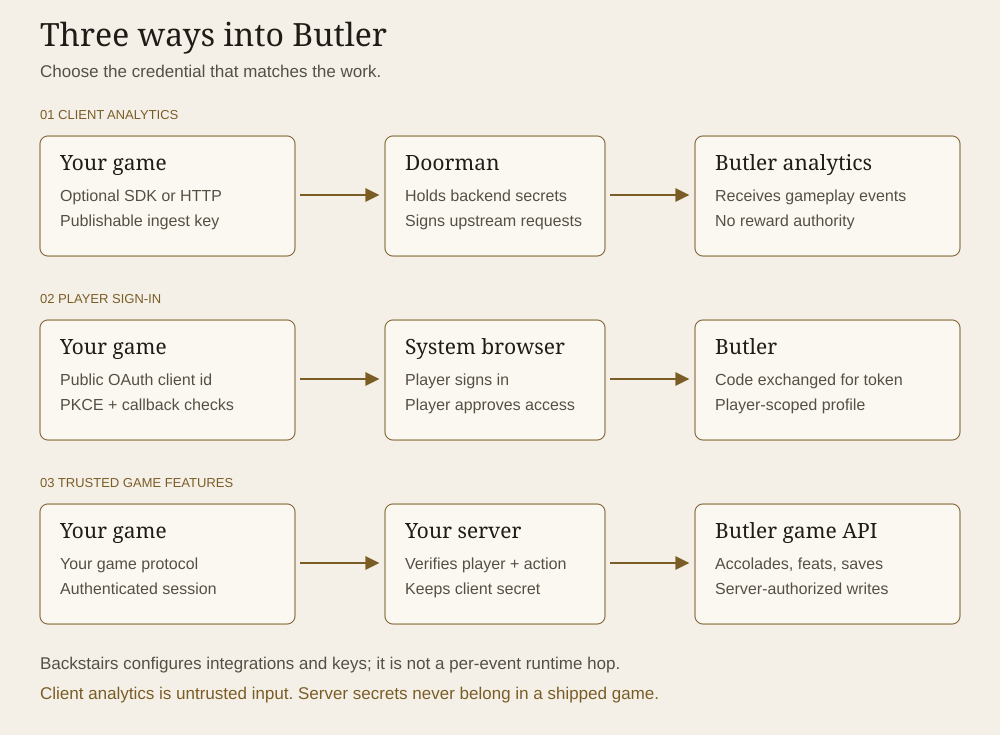
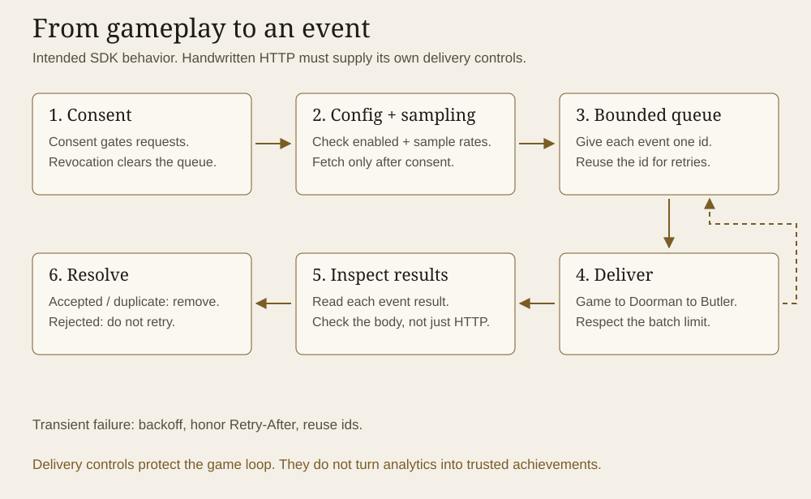

# How Butler fits your game

An SDK is a convenience layer inside your application. It does not create a new trust boundary or grant extra permissions. The same HTTP contracts apply when you write the requests yourself.

## Three paths, three credentials

| Path | Credential | Responsibility |
|---|---|---|
| Game to Doorman to Butler analytics | Publishable ingest token and proxy key | The game reports events; Doorman holds the backend credentials and signs upstream requests. |
| Game to Butler sign-in and player profile | Public OAuth client id, then a per-player token | Sign-in uses the system browser and PKCE. Validate the callback before exchanging the code. |
| Your server to Butler game features | Server client id and secret, then a server token | Your server authenticates the player, checks the action and makes the trusted write. |

Publishable keys may be extracted from builds by design. Server secrets must stay on infrastructure you control. A player token represents a signed-in player; it is not a server credential. See [concepts](concepts.md) for the full credential model.

Backstairs manages integrations and configuration; it is not a runtime hop for each gameplay event. Partner and third-party access to client analytics depends on provisioning, described in [integration paths](integration-paths.md).

## An analytics event's journey

This is the intended SDK delivery model, not a claim that the packages are implemented. The [fixtures](../conformance/README.md) describe the behavior packages must satisfy.

1. Consent gates network activity. With required consent, do not send events or fetch config before the player agrees. Revocation stops sending and purges the queue.
2. Remote config controls whether events may be sent and how they are sampled. Queue and batch sizes remain bounded.
3. Assign an event id once. Preserve it across delivery retries so Butler can recognize duplicates.
4. Read each batch result. Remove accepted and duplicate events; do not repeatedly send rejected events. Retry transient transport failures with backoff and honor `Retry-After`.

Analytics is observational. An event claiming "boss defeated" must not itself award an accolade. Your server verifies the outcome and the player before calling the server API.

## Where to look next

- [Gateway contract](../spec/doorman.openapi.json): client analytics routes, credentials and gateway-version behavior.
- [Butler client contract](../spec/butler.client.openapi.json): request fields, responses and `x-butler-tier` annotations.
- [Player sign-in](guides/player-sign-in.md): the authorization-code exchange and token lifecycle.
- [Game server guide](guides/game-server.md): token acquisition and trusted game operations.

These diagrams summarize the public integration surface. They do not describe internal deployment topology or guarantee live-service availability.
